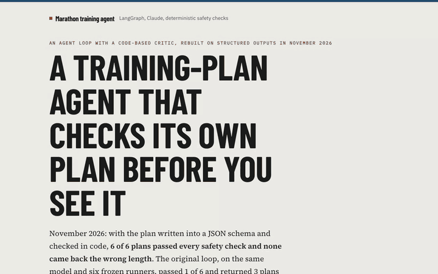

# Marathon training agent

[](https://github.com/lyhjeremy/marathon-training-agent/actions/workflows/tests.yml)



A LangGraph agent that writes a personalized marathon training plan, then critiques it with deterministic safety checks and revises it until it passes.
In November 2026 the plan moved into a JSON schema validated in code: on six frozen runners, 6 of 6 structured plans passed every check and none came back the wrong length, against 1 of 6 and 3 length drifts for the original loop on the same model, at a median $0.10 and 47 s a plan against $0.22 and 114 s.
On its own three-runner safety panel (five plans, 2026-11-05) the loop moved plans passing all four checks from 1 in 5 to 2 in 5, and one of the two came back 18 weeks long for a 10-week runner; each plan cost $1.19 API-equivalent and took 172 s median.

[Live site](https://lyhjeremy.github.io/marathon-training-agent/) · [Write-up](https://lyhjeremy.github.io/marathon-training-agent/overview/) · [Long-form notes](writeup.md) · [Recorded run](examples/sample_run.md)

Design and copy follow [these standards](https://github.com/lyhjeremy/lyhjeremy/blob/main/DESIGN_STANDARDS.md).

## Structured outputs (November 2026)

`src/schema.py` defines the plan as pydantic models (seven sessions a week, each a day, a type from a fixed list and a distance) and a validator for what the schema cannot say: the week count equals the runner's input, weeks run 1 to N, each day once, running days within the runner's limit, phases in order, the race in the last week. `assess_runner` replaces the LLM's feasibility call with Riegel's formula from a recent half marathon and a 10%-rule peak mileage. `src/structured.py` is the new LangGraph loop: assess in code, one draft, validate in code, up to two repairs that quote the errors back.

`eval/structured_eval.py` ran both agents on six runners frozen at `d397cd5` (`eval/structured/runners.json`): the three November 5 profiles with a recent half added, and three new ones. Same model (claude-sonnet-5-5), same isolated CLI flags, one plan at a time on an Apple M4, 2026-11-13. Cost is the API-equivalent `total_cost_usd` the Claude CLI reports.

| | Original loop | Structured |
|---|---|---|
| Plans passing all checks (of 6) | 1 | 6 |
| Plans with the wrong number of weeks | 3 (17 for 12, 18 for 10, 15 for 8) | 0 |
| Safety issues left in final plans | 8 | 0 |
| Model calls per plan | 7.7 | 1.8 |
| Cost per plan, median | $0.22 | $0.10 |
| Latency per plan, median / p95 | 114 s / 129 s | 47 s / 66 s |
| Target time across three runs | varied 0 to 5 min (LLM) | identical (code) |

Every length drift came from a revision; the drafts all had the right length. On runner r2 the LLM reviewer called a 10-week build "too short", and the revisions lengthened it to 18 weeks. The structured agent's own failure: 4 of 6 first drafts broke the schema's 120-character limit on a session note, and one repair introduced a ramp jump that the next repair removed. Six runners and one run each is a small sample, and dropping the LLM reviewer means nothing now checks things like long-run share. Results: `eval/structured/results.json`; every plan and call: `runs_before.jsonl`, `runs_after.jsonl`, `runs_assess.jsonl`. 69 model calls in all.

The November 5 figures below ($1.19 and 172 s a plan) were on claude-opus-5-5 with the CLI's default system prompt; the wrapper now runs isolated on sonnet, which is most of the cost difference.

### MCP server

`src/mcp_server.py` serves `assess_runner`, `plan_schema`, `validate_plan` and `safety_checks` over stdio (official `mcp` SDK). No tool calls a model. `tests/test_mcp.py` starts it and validates a plan through it.

```bash
claude mcp add plan-checks -- ~/venvs/marathon-training-agent/bin/python /path/to/marathon-training-agent/src/mcp_server.py
```

```bash
P=~/venvs/marathon-training-agent/bin/python
$P -m eval.structured_eval --system before; $P -m eval.structured_eval --system after
$P -m eval.structured_eval --system assess; $P -m eval.structured_eval --summarize
$P -m eval.export_web; $P -m pytest -q tests
```

## Results (November 5, 2026)

One recorded run, from [`examples/sample_run.md`](examples/sample_run.md): Boston, goal 3:05, 16 weeks, 22 miles a week, longest recent run 9 miles, 74°F forecast.

- `assess` judged the goal unrealistic and recommended 3:20, peaking around 45 miles a week.
- `critique` found 5 issues in the first draft, including a week-5 mileage jump above 20% (23 to 28 miles). One `revise` pass fixed them and the second critique came back clean.
- The final 16-week plan includes downhill quad work from week 3, Newton-style hill repeats, a 19-mile Boston simulation in week 12, and a taper to 22 miles in race week.

`python -m eval.measure` runs the three synthetic runners from `src/eval.py` through the same nodes (Boston and New York twice, Berlin once, stopping after 34 CLI calls), scores the raw draft and the final plan with `_safety_checks`, and records the cost and time of every Claude CLI call. Run on 2026-11-05 on an Apple M4:

| | Raw draft | After the loop |
|---|---|---|
| Plans passing all four checks | 1 of 5 | 2 of 5 |
| Safety issues, all plans | 6 | 5 |

- Revision loops: 1.8 per plan (four plans used both revisions, one used one). The LLM review raised issues of its own in 11 of 14 critique rounds, which is why most plans ran out of revisions.
- Cost: $1.19 median API-equivalent per plan ($0.98 to $1.38, n = 5), 6 to 8 calls on Opus 5.5, the CLI's default. This is the `total_cost_usd` that `claude -p --output-format json` reports; the CLI runs on a subscription, so nothing was billed.
- Latency: 172 s median, 179 s p95 per plan (n = 5). `revise` is the slowest node at 32 s median per call.
- Failures: one plan passed only because its revision came back 18 weeks long for a 10-week runner (no check compares the length); one revision turned one ramp jump into two; one left both jumps in place; one fixed two and added a new one. The same Boston runner was assessed at 3:45 in one run and 4:15 in the other. Hand-coded in `eval/error_analysis.json`; every draft and final plan is in `eval/runs.json`.

The [write-up page](https://lyhjeremy.github.io/marathon-training-agent/overview/) has a JavaScript port of `_safety_checks` that you can run against edited versions of the recorded plan.

## How it works

The agent is a LangGraph `StateGraph` over a typed state (`profile`, `assessment`, `weeks`, `critique`, `revisions`, `log`).

| Node | What it does |
|---|---|
| `assess` | Judges whether the goal is realistic; returns a recommended goal time and peak weekly mileage as JSON |
| `plan` | Drafts a periodized plan (Base, Build, Peak, Taper) in a fixed JSON week schema |
| `adjust` | Tailors workouts to the race with figures from `src/knowledge.py`: course penalty against Berlin (simulated figures, labeled as such; see the limitations), about 1 minute per °F above 55°F, the 30 km wall |
| `critique` | Runs `_safety_checks` in Python, merges in issues from an LLM review, passes only with zero issues |
| `revise` | Fixes the flagged issues and returns the plan to `critique` |

`_safety_checks` flags four things: a week-over-week mileage increase above 20%, a race week above 75% of peak mileage, a long run over 22.5 miles, and a long run longer than its week's total. A conditional edge sends the plan to `revise` while issues remain and the revision budget (2 by default, `--max-revisions`) isn't spent. A full run makes 4 to 8 LLM calls.

The course and heat figures come from my own analyses: [Majors course difficulty](https://lyhjeremy.github.io/marathon-majors-course-difficulty/), [the heat tax](https://lyhjeremy.github.io/marathon-heat-tax/), [pacing decay](https://lyhjeremy.github.io/marathon-pacing-decay/) and [negative splits](https://lyhjeremy.github.io/marathon-negative-split-myth/).

## Stack

Python, LangGraph, Claude (Claude CLI by default, Anthropic API with `ANTHROPIC_API_KEY`), Streamlit, pandas, matplotlib.

## How to run

```bash
git clone https://github.com/lyhjeremy/marathon-training-agent && cd marathon-training-agent
python3 -m venv .venv && source .venv/bin/activate
pip install -r requirements.txt

python -m src.cli --race boston --goal 3:05:00 --weeks 16 \
    --current-mpw 22 --longest 9 --days 5 --temp 74

python -m src.cli            # interactive prompts
streamlit run app.py         # browser UI that streams each node
python -m src.eval           # safety before/after the loop -> eval/results.csv, eval/safety_gain.png
```

Set `CLAUDE_MODEL` (for example `haiku`) to trade some quality for speed across the agent's calls.

## Repo layout

| Path | What it is |
|---|---|
| `src/graph.py` | The LangGraph state machine: nodes, safety checks, the revise loop |
| `src/knowledge.py` | Course-difficulty (simulated), heat-tax and pacing figures from my analyses |
| `src/util.py` | JSON extraction from LLM output |
| `src/eval.py` | Safety evaluation of the critique/revise loop |
| `eval/` | `measure.py` (the 2026-11-05 panel run with cost and latency), its runs, per-call rows and error analysis |
| `src/llm.py` | LLM wrapper: Claude CLI (default) or Anthropic API |
| `src/cli.py` | Collect inputs, run the agent, print the plan and agent trace |
| `app.py` | Streamlit UI |
| `examples/sample_run.md` | The recorded run quoted above |
| `index.html`, `overview/`, `privacy/`, `terms/` | The site |

## Limitations

- The measured panel is five plans from three synthetic runners, too few for a stable rate.
- No check compares the plan's length with the weeks asked for, or its first week with the runner's current mileage.
- Only four rules are deterministic. Intensity balance, monotony and too many hard days depend on the LLM reviewer.
- In the recorded run the final plan peaked at 57 miles, above the 45 the assessment suggested; no check compares the two.
- The course figures in `src/knowledge.py` are simulated. They come from an earlier version of my Majors course-difficulty simulation (a simulated field with course penalties planted in code), so they don't measure the courses, and they differ from the current study (the file has London 28 s, Tokyo 33 s and a Boston index of 1.036; the study's paired method gives 30.7 s, 21.0 s and a composite of 1.0092). The file says so in a comment, and the course line in the `adjust` prompt labels the figure as a simulated estimate, not a race result. They only steer the wording of `adjust`; no safety check reads them.
- 2026-10-28: the simulated-data label was added after the recorded run in `examples/`; the values are unchanged.
- The rules are general defaults that ignore individual physiology, and the plan doesn't adapt to logged training.
- Educational tool, not medical or professional coaching advice.

## License

[MIT](LICENSE) © 2026 Jeremy Lee
