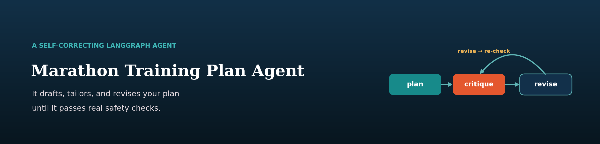
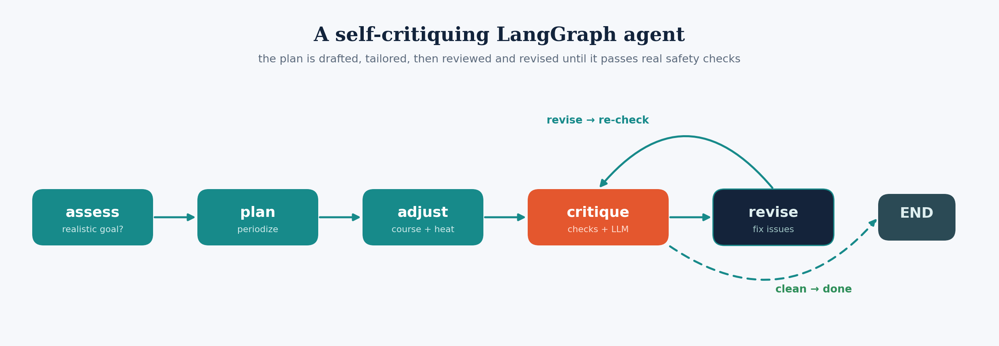

  

# A Marathon Plan That Reviews Itself

*Wrapping an LLM in a LangGraph feedback loop so the plan it gives you has
survived criticism — not just generation.*

## The problem with "write me a training plan"

Ask any chatbot for a 16-week marathon plan and you'll get a confident, tidy
table. Look closely and it often ramps mileage 30% week-over-week, forgets to
taper, or casually prescribes a 26-mile long run. The output *looks* expert; it
isn't reviewed. For something with real injury risk, generate-and-hope isn't good
enough.

## The fix: make the model critique itself

This project is a **LangGraph agent** — the LLM runs inside a state machine with a
feedback loop:

  

- **assess** judges whether the goal time is realistic given current fitness and
  timeline, and proposes a smarter target if not.
- **plan** drafts a periodized week-by-week build (Base → Build → Peak → Taper).
- **adjust** tailors it to the *specific* race, drawing on my own marathon data
  analyses — [course difficulty](https://github.com/lyhjeremy/marathon-strategy-rag)
  (Boston's Newton hills demand downhill/quad work) and the [heat
  tax](https://github.com/lyhjeremy/marathon-strategy-rag) (~1 min/°F → a hot-day
  pace band and heat acclimation).
- **critique** is the heart of it: **deterministic** safety checks (no >20%
  mileage jumps, a real taper into race week, longest run ≤ ~22 mi, long run ≤
  weekly total) *plus* an LLM review for realism.
- **revise** fixes exactly what critique flagged and loops back — up to a
  revision budget.

The key design choice is that critique isn't only an LLM asking itself "is this
good?" (models are bad at that). Half of it is **objective, coded rules**. The LLM
handles judgement; the rules handle guarantees.

## It actually catches things

Asked for a **3:05 Boston off 22 mi/week with a 9-mile longest run, on a 74°F
day**, the agent:

1. **assessed** the goal as unrealistic and recommended **3:20** — *"starting from
   22 mi/week and a 9-mile longest run leaves too little runway in 16 weeks to
   safely build both mileage and speed."*
2. drafted and then **tailored** the plan: Newton-style hill repeats, sustained
   downhill running for quad durability, a 19-mile Boston race-simulation with the
   hills at mile 15–19, and hot-day pace-band rehearsals.
3. **critique caught 5 issues** on the first draft (including a >20% mileage jump);
   **revise** fixed them; the second critique came back **clean**.

The full run is in [`examples/sample_run.md`](examples/sample_run.md). Every run
prints its **agent trace**, so the self-correction is visible, not hidden.

That single run is an anecdote; `src/eval.py` turns it into a measurement. It runs
the agent across a panel of synthetic runners and compares each plan's safety —
scored by the agent's *own* deterministic checks — before the critique/revise loop
(the raw draft) versus after it, reporting the pass-rate lift and the drop in mean
safety issues. Run `python -m src.eval` to reproduce it. And because the plan is
just data, there's now a **Streamlit UI** (`streamlit run app.py`) that streams the
agent through its nodes live so you can watch it draft, critique, and revise.

## Design notes

- **LangGraph** models this naturally: nodes are plain functions, and a single
  `add_conditional_edges("critique", …)` gives the revise-or-finish loop, bounded
  by a revision budget to guarantee termination.
- **Generation runs on the Claude CLI** (my Claude subscription — no per-token
  cost) or the Anthropic API if a key is set. A full run makes ~6–8 calls; set
  `CLAUDE_MODEL=haiku` to trade a little polish for speed.
- **Termination is guaranteed** by the `max_revisions` budget and LangGraph's
  recursion limit — the loop can't run forever.

## Limitations & next steps

- The safety rules are sensible defaults, not individualized physiology; a real
  coach personalizes far more.
- No periodization of *intensity* distribution yet (e.g. enforcing ~80/20
  easy/hard) — a good next deterministic check.
- It plans; it doesn't adapt week-to-week to how training is actually going —
  turning it into a plan that ingests your logged runs is the natural extension.

*Code: [github.com/lyhjeremy/marathon-training-agent](https://github.com/lyhjeremy/marathon-training-agent)*
